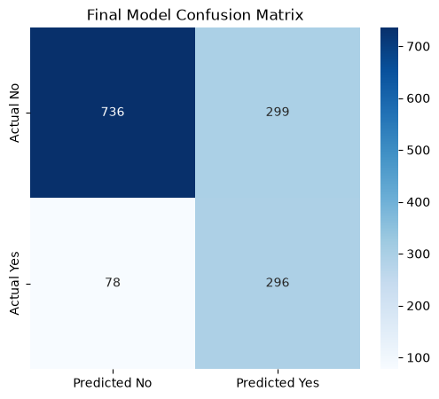
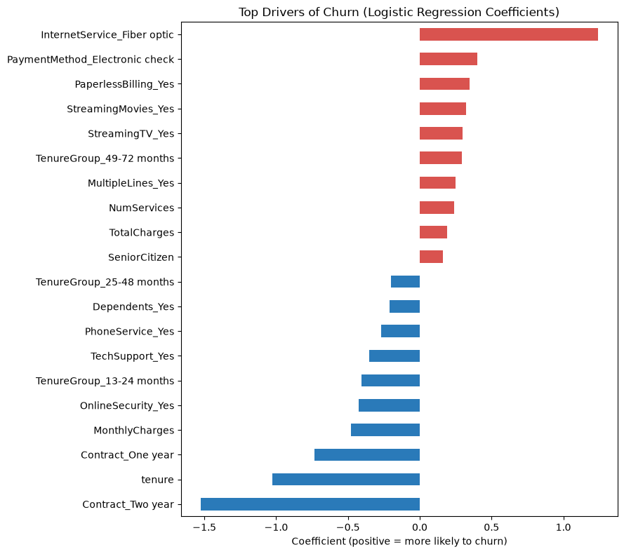

# Customer Churn Prediction

## Project Overview

This project is part of the NexAfrica Machine Learning Internship. It builds a machine learning classification model that predicts whether a telecom customer is likely to churn, meaning stop doing business with the company, based on demographic information, account details, subscribed services, contract type, tenure, and billing information.

The project follows a complete end-to-end workflow: business understanding, data preparation, exploratory data analysis, feature engineering, model development, evaluation, class imbalance handling, optimization, feature importance, and business recommendations.

## Business Problem

Customer churn is the rate at which customers stop doing business with a company. Losing a customer costs more than it appears to, because replacing them requires marketing and sales expense, and the company also loses the future revenue that customer would have generated.

The goal is a model that produces a churn probability for each customer, rather than a plain yes or no. With this score, a company can group customers into risk tiers and offer discounts or incentives to the highest-risk customers, while monitoring lower-risk ones.

## Dataset

The Telco Customer Churn dataset, with 7,043 customer records and 21 columns covering demographics, account information, subscribed services, contract type, billing, and the target variable, Churn. Raw and processed versions are stored in the `data/` directory.

## Tools and Technologies

- Python
- Pandas and NumPy
- Matplotlib and Seaborn
- Scikit-learn
- Imbalanced-learn (SMOTE)
- Jupyter Notebook
- Git and GitHub

## Project Workflow

Business Understanding, Data Collection, Data Cleaning, Exploratory Data Analysis, Feature Engineering, Model Training, Model Evaluation, Class Imbalance Handling, Hyperparameter Tuning, Feature Importance, Business Recommendations.

## Current Progress

**Week 1: Business Understanding, Data Collection and Data Preparation (Complete)**

- Defined the business problem and project objective
- Loaded and inspected the dataset (7,043 rows, 21 columns)
- Built a data dictionary describing every feature
- Found and resolved a data quality issue in TotalCharges, where 11 rows held blank values for customers with zero tenure, by converting the column to numeric and filling those values with 0
- Confirmed no duplicate records and no inconsistent categorical values
- Analyzed the target variable: 73.5 percent of customers stayed and 26.5 percent churned

**Week 2: Exploratory Data Analysis and Feature Engineering (Complete)**

- Produced 8 visualizations and documented 8 data-driven insights on churn patterns
- Engineered three features: NumServices, TenureGroup, and HasInternetService
- One-hot encoded categorical variables, scaled numeric features, and saved a machine-learning-ready dataset

**Week 3: Machine Learning Model Development (Complete)**

- Created a stratified train-test split
- Trained Logistic Regression, Decision Tree, and Random Forest models
- Evaluated each with accuracy, precision, recall, F1-score, ROC-AUC, and confusion matrices
- Selected Logistic Regression as the initial model based on recall, F1-score, and ROC-AUC rather than accuracy

**Week 4: Class Imbalance Handling and Model Optimization (Complete)**

- Quantified the class imbalance (2.77 non-churners per churner)
- Compared class weighting and SMOTE; class weighting raised Logistic Regression recall from 51.9% to 79.1% without reducing ROC-AUC
- Applied 5-fold stratified cross-validation to confirm consistent results
- Tuned the Decision Tree (GridSearchCV) and Random Forest (RandomizedSearchCV)
- Selected class-weighted Logistic Regression as the final model

**Week 5: Interpretation, Business Insights and Final Project (Complete)**

- Evaluated the final model on the held-out test set
- Analyzed feature importance using Logistic Regression coefficients
- Analyzed false positives and false negatives and their business impact
- Produced 7 data-backed business recommendations

## Exploratory Data Analysis

Churn is strongly associated with short tenure, month-to-month contracts, electronic check payments, fiber optic internet, and senior citizen status. Full analysis and visualizations are in the Week 2 notebook.

## Machine Learning Models

Three model families were trained and compared: Logistic Regression, Decision Tree, and Random Forest. Each was tested at baseline and again after class imbalance handling and tuning. Class-weighted Logistic Regression was selected as the final model.

| Model | Accuracy | Precision | Recall | F1-Score | ROC-AUC |
|---|---|---|---|---|---|
| Logistic Regression (baseline) | 0.7999 | 0.6554 | 0.5187 | 0.5791 | 0.8424 |
| Logistic Regression (class weighted) | 0.7324 | 0.4975 | 0.7914 | 0.6109 | 0.8421 |
| Decision Tree (tuned) | 0.7424 | 0.5092 | 0.8102 | 0.6254 | 0.8375 |
| Random Forest (tuned) | 0.7530 | 0.5233 | 0.7807 | 0.6266 | 0.8418 |

Cross-validated (5-fold) results for the final model: mean recall 0.802, mean F1 0.626, mean ROC-AUC 0.846, with small standard deviations across folds.

**Why this model:** After tuning, the three finalists performed almost the same on ROC-AUC. Logistic Regression was chosen for its stronger and more stable cross-validated recall, which matters most because a missed churner is the costliest error, and because it is the easiest model to explain to a business audience.

## Evaluation Metrics

Models were evaluated using accuracy, precision, recall, F1-score, ROC-AUC, and confusion matrices. Accuracy alone was not used for model selection because of the class imbalance.



On the test set of 1,409 customers, the final model caught 296 of 374 churners (recall 79.1%), missed 78, and raised 299 false alarms.

## Key Findings

- Month-to-month customers churn at 42.7%, versus 11.3% on one-year and 2.8% on two-year contracts.
- Electronic check customers churn at 45.3%, more than double the other payment methods.
- Fiber optic customers churn at 41.9%, versus 19.0% for DSL.
- Churned customers have a median tenure of about 10 months, versus about 38 for customers who stayed.
- Among internet customers, churn is 15.2% with tech support versus 41.6% without, and 14.6% with online security versus 41.8% without.
- Senior citizens churn at 41.7%, versus 23.6% for other customers.
- The largest model coefficients are Contract_Two year (-1.52), InternetService_Fiber optic (+1.24), and tenure (-1.03).
- Missed churners tend to look low-risk, with longer tenure, lower charges, and more contract commitment.



**Note:** Coefficients for overlapping features such as tenure, TenureGroup, TotalCharges, and MonthlyCharges should not be read in isolation, because they are correlated with each other. All findings show association, not proven cause.

## Business Recommendations

1. **Encourage longer contracts.** Offer perks to month-to-month customers who move to a one-year or two-year plan.
2. **Move electronic check users to automatic payment.** Offer a small incentive to switch to bank transfer or card auto-pay.
3. **Review fiber optic quality and pricing.** Investigate reliability and price competitiveness for the highest-churn service tier.
4. **Launch an early onboarding program.** Provide check-ins and support during the first 12 months, when most churn happens.
5. **Bundle tech support and online security.** Offer trials to at-risk internet customers who do not have them.
6. **Give senior citizens targeted support.** Provide simpler plans and phone-based outreach.
7. **Target retention spending using churn probabilities.** Call only the top-risk tier, send low-cost offers to the medium tier, and monitor the rest to limit wasted offers.

## Limitations and Future Improvements

- The final model has a precision of about 50%, so roughly half of its flags are false alarms.
- Findings are associations, and retention actions should be tested before wide rollout.
- Future work could tune the decision threshold using real intervention costs, test additional models such as XGBoost, and validate on newer customer data.

## How to Run the Project

1. Clone this repository:

```
git clone https://github.com/aimlin9/Customer-Churn-Prediction.git
```

2. Install the dependencies:

```
pip install -r requirements.txt
```

3. Open the notebooks in the `notebooks/` directory using Jupyter Notebook or Google Colab, in week order.

## Project Structure

```
Customer-Churn-Prediction/
├── data/
│   ├── raw_data/
│   └── processed_data/
├── notebooks/
│   ├── Week1_Business_Model.ipynb
│   ├── Week2_EDA_FeatureEngineering.ipynb
│   ├── Week3_Model_Development.ipynb
│   ├── Week4_Optimization.ipynb
│   └── Week5_Final_Evaluation.ipynb
├── src/
├── visuals/
│   ├── final_confusion_matrix.png
│   └── feature_importance.png
├── README.md
└── requirements.txt
```